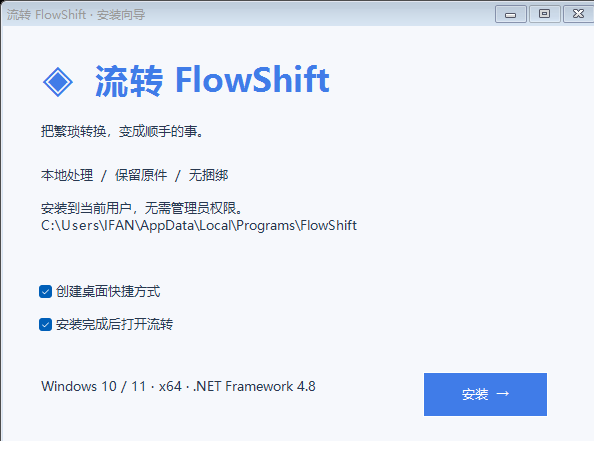

# 流转 FlowShift

> 本地格式转换器 · 桌面悬浮 · 文件右键菜单 · 格式罗盘 · 批量处理
> A local Windows file-format converter: floating dock, Explorer context menu, radial format wheel, and batch processing.

[](LICENSE.txt)
[](https://github.com/jingpanlong/FlowShift/releases)

[中文](#中文) · [English](#english)

---

## 中文

### 简介
**流转 FlowShift** 是一款 Windows 桌面**本地格式转换工具**。它以一个浅色悬浮胶囊常驻桌面：拖入文件就地展开，点击目标格式即转换，进度与结果都留在悬浮层。提供资源管理器右键菜单、长按右键唤出的「格式罗盘」、贴边收纳、批量与参数化转换。

**一切在本地完成**：文件不上传，原件保留。转换内核复用开源的 [Filee](https://github.com/KnifeLemon/Filee)（MIT）。

### 功能特性
- **贴边悬浮胶囊**：拖动到屏幕四边自动收成薄标签，点击或拖入文件展开，位置自动保存。
- **资源管理器右键「流转 · 转换格式」**：常用格式 + 选择其他格式（Windows 11 在「显示更多选项」）。
- **格式罗盘**：选中文件长按右键约 650 ms 唤出，指向格式松开即转；键盘快捷键亦可打开（默认 `Ctrl+Alt+Space`）。
- **批量与参数化转换、配方编辑、进度取消、结果与引擎安装**。
- **单实例复用、系统托盘、自动文件夹、配置与历史本地保存**。
- 支持 **255 种真实文件格式定义**（含「解压文件夹」伪格式）；格式有只读/只写/依赖差异，并非任意两种都能互转。

### 截图




### 下载与安装
前往 [Releases](https://github.com/jingpanlong/FlowShift/releases) 下载：
- `FlowShift241.exe`：**单文件版**，双击即用，无需安装。
- `FlowShift241-Setup.exe`：**安装版**，用户级安装，提供开始菜单/桌面快捷方式，卸载时清理本程序注册的右键菜单。

要求 **Windows 10/11 x64**。

### 开源与源码
- 本项目仓库：<https://github.com/jingpanlong/FlowShift>
- 转换内核 Filee（MIT）：<https://github.com/KnifeLemon/Filee>

### 从源码构建
要求：Windows 10/11 x64、.NET Framework 4.8、.NET 10 SDK，以及可访问依赖下载的网络连接；构建空间建议 ≥ 10 GB。

1. 获取转换内核源码（固定提交，详见 [`UPSTREAM.txt`](UPSTREAM.txt) 与 [`Vendor/README.md`](Vendor/README.md)）：
   ```powershell
   git clone https://github.com/KnifeLemon/Filee.git Vendor/Filee
   cd Vendor/Filee && git checkout 799e39485f2aa78677f9ba51f692e862a7af76a6 && cd ..
   ```
2. 完整构建（还原 NuGet、构建内核、下载并校验 7-Zip/rhwp/运行库与可选引擎，生成单文件程序与安装版）：
   ```powershell
   powershell -NoProfile -ExecutionPolicy Bypass -File .\build-full.ps1 -Dotnet 'C:\Program Files\dotnet\dotnet.exe'
   ```
   产物在源码目录上一级：`FlowShift241.exe`、`FlowShift241-Setup.exe`。
   只构建较小的可选安装引擎版：`build-full.ps1 -SkipEngineDownloads`；已有 `core-payload.zip` 时只改界面/安装器可直接 `build.ps1`，无需 .NET SDK。

### 许可证
本项目以 [MIT 许可证](LICENSE.txt) 发布。转换内核 Filee 及其开源组件保留各自许可证（详见 [`THIRD-PARTY-NOTICES.txt`](THIRD-PARTY-NOTICES.txt) 与 `Vendor/Filee`）。

---

## English

### Overview
**FlowShift** is a **local Windows file-format converter**. A light floating capsule lives on your desktop: drop a file in and it expands in place; click a target format to convert — progress and results stay in the floating layer. It also offers an Explorer context-menu entry, a long-press right-click "format wheel", edge-docking, and batch/parameterized conversion.

**Everything runs locally**: files are never uploaded and originals are preserved. The conversion engine reuses the open-source [Filee](https://github.com/KnifeLemon/Filee) core (MIT).

### Features
- **Edge-docking floating capsule** that collapses to a thin tab on any screen edge.
- **Explorer context menu** "流转 · 转换格式" (FlowShift · Convert) with common formats and "choose other format".
- **Radial format wheel**: long-press right-click (~650 ms) on selected files, point at a format, release to convert. Keyboard shortcut also supported (default `Ctrl+Alt+Space`).
- **Batch & parameterized conversion**, recipe editing, progress cancellation, result and engine installation.
- **Single-instance**, system tray, auto folder, local config & history.
- **255 real file-format definitions** (plus an "extract folder" pseudo-format); formats have read-only/write-only/dependency differences — not every pair is convertible.

### Download & Install
Get builds from [Releases](https://github.com/jingpanlong/FlowShift/releases):
- `FlowShift241.exe`: single-file build, run directly, no install.
- `FlowShift241-Setup.exe`: installer (per-user), with Start Menu / desktop shortcuts; uninstall removes the context-menu entries it owns.

Requires **Windows 10/11 x64**.

### Source & Build
Requires Windows 10/11 x64, .NET Framework 4.8, .NET 10 SDK, and network access for dependency downloads; ~10 GB free space recommended.

1. Fetch the conversion core at the pinned commit (see [`UPSTREAM.txt`](UPSTREAM.txt) and [`Vendor/README.md`](Vendor/README.md)):
   ```powershell
   git clone https://github.com/KnifeLemon/Filee.git Vendor/Filee
   cd Vendor/Filee && git checkout 799e39485f2aa78677f9ba51f692e862a7af76a6 && cd ..
   ```
2. Full build:
   ```powershell
   powershell -NoProfile -ExecutionPolicy Bypass -File .\build-full.ps1 -Dotnet 'C:\Program Files\dotnet\dotnet.exe'
   ```
   Output (one level above the source dir): `FlowShift241.exe`, `FlowShift241-Setup.exe`.
   Smaller optional-engine build: `build-full.ps1 -SkipEngineDownloads`. With an existing `core-payload.zip`, `build.ps1` alone rebuilds the UI/installer without the .NET SDK.

### License
Released under the [MIT License](LICENSE.txt). The Filee conversion core and its open-source components keep their own licenses (see [`THIRD-PARTY-NOTICES.txt`](THIRD-PARTY-NOTICES.txt) and `Vendor/Filee`).

---

## 关于 / About
作者联系：微信公众号「景同志」，小红书「景同学」。
开源地址与下载见上方 Releases 与仓库首页。

> 仓库主页：<https://github.com/jingpanlong/FlowShift> · 下载：<https://github.com/jingpanlong/FlowShift/releases>
